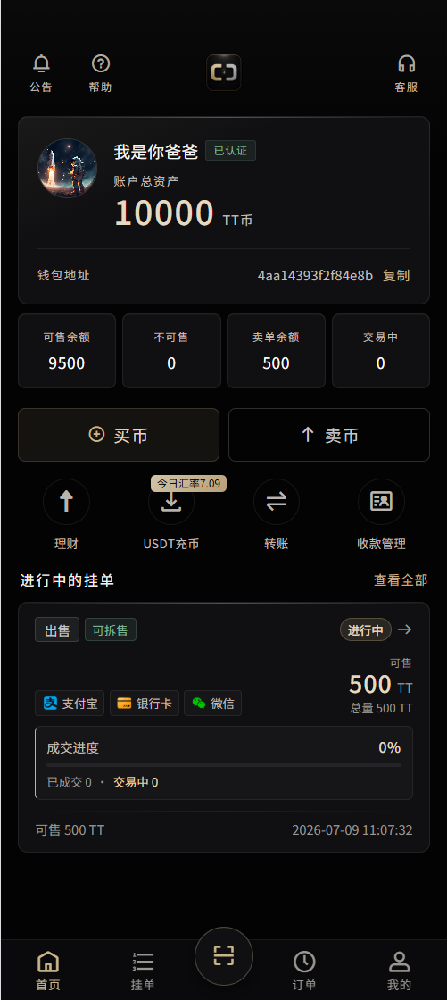
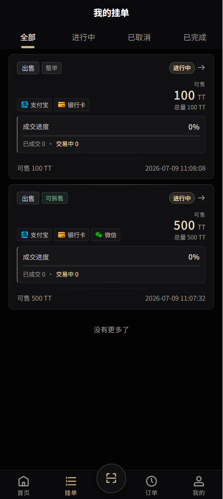
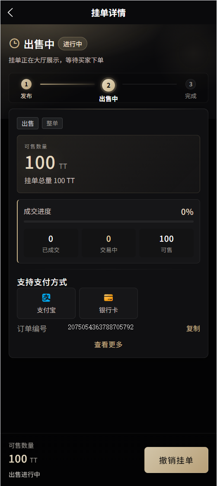
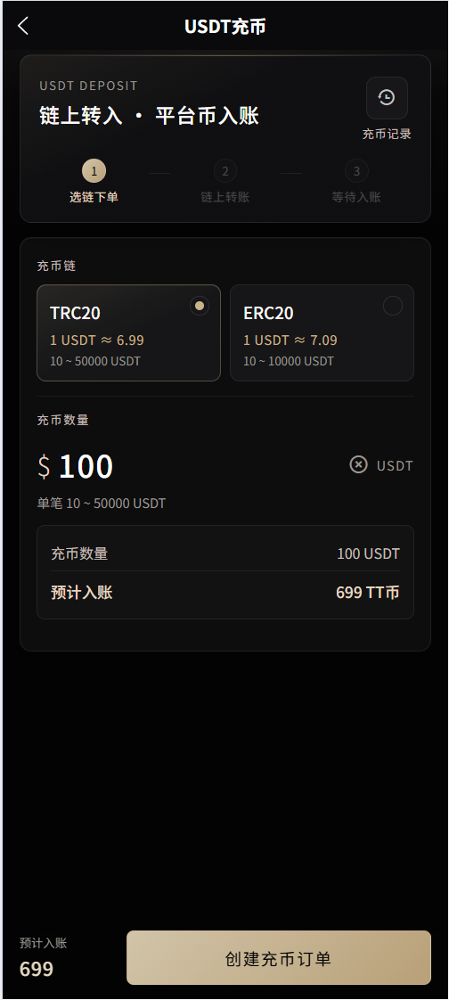
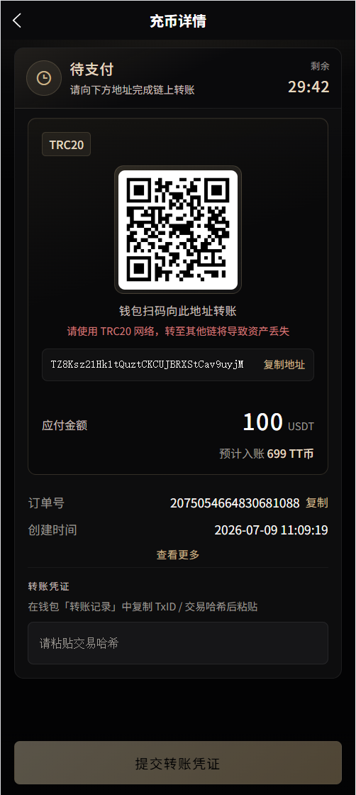
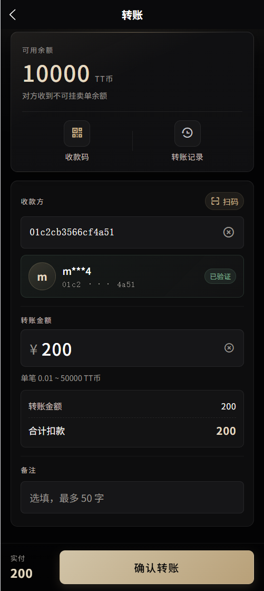
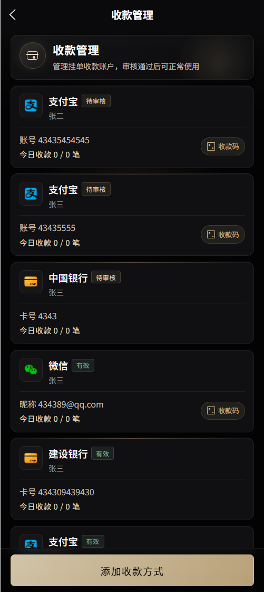
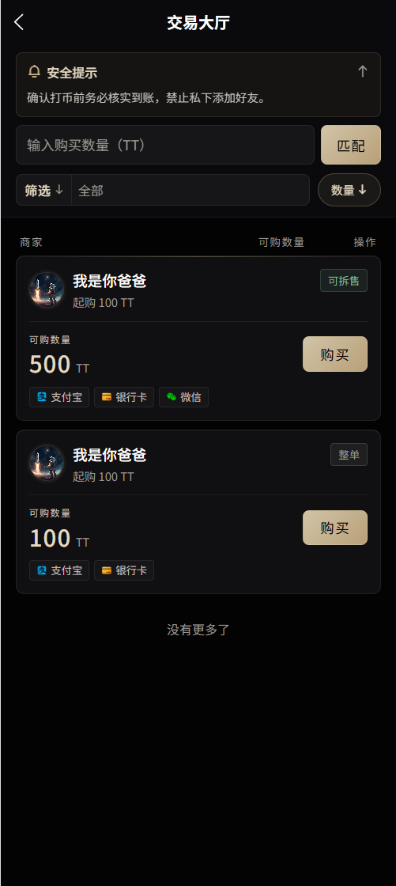
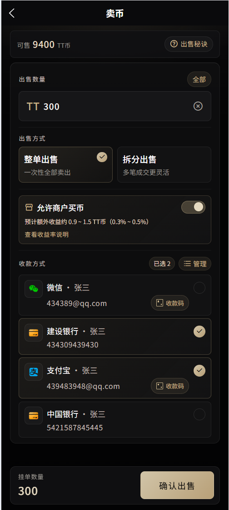

## 介绍

2026年最新c2c钱包，该项目基于Java开发。 

* 后端采用Spring Boot、Spring Data Jpa、Sa Token、 Redis、Mysql。
* 前端采用uniapp跨端开发，一套代码，可发布到iOS、Android、Web（响应式）等多个平台，另外还有更流畅的flutter版本。
* 本项目主要供交流学习，请不要用于商业项目。

## 联系我们
如需获取最新版本,请联系我们：纸飞机 Telegram：muyu8848

## 在线体验
  
##### h5版本：http://101.35.227.238:9006
测试账号：13533333333，密码：123  
也可以自行注册账号
##### 商户系统：http://101.35.227.238:9005/page/login
测试账号：sh1，密码：123
##### 运营后台：http://101.35.227.238:9004/page/login
测试账号：admin，密码：123

## 演示图
<table>
    <tr>
        <td></td>
        <td></td>
<td></td>
    </tr>
<tr>
        <td></td>
        <td></td>
<td></td>
    </tr>
<tr>
        <td></td>
        <td></td>
<td></td>
    </tr>
	 
</table>

